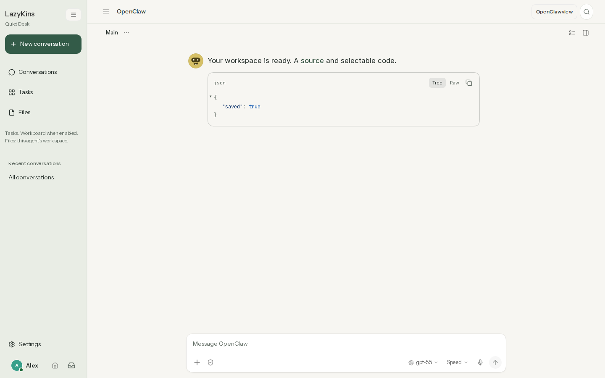
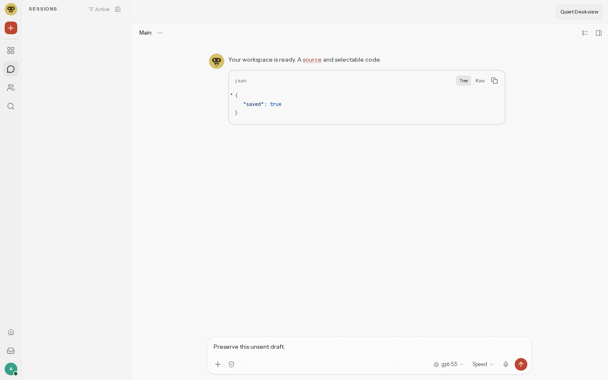

# LazyKins and Sanitize — OpenClaw 2026.11.6

Updated and verified November 20, 2026 against stable [OpenClaw 2026.11.6](https://github.com/openclaw/openclaw/releases/tag/v2026.11.6), source `06afb10d3272cc9deaf38ca6a3b7b839d5935638`. Newer beta releases are excluded.

[Download the verified installers](https://github.com/svetlyoh/web-wallet/actions/runs/44797380473/artifacts/14658464600) (GitHub sign-in required). Unpack that artifact to get the combined ZIP, separate LazyKins/Sanitize ZIPs and `archives.sha256`. Use the combined ZIP for installation; this source folder does not contain the generated UI payload.

[Successful Linux build and browser checks](https://github.com/svetlyoh/web-wallet/actions/runs/44797380473) · [Full installation and rollback guide](docs/OPERATOR-GUIDE.md) · [Verification](docs/VERIFICATION.md)

## Install on Linux

Copy `LazyKins-Sanitize-2026.11.6.zip` to Downloads. Run as the same Linux user that runs OpenClaw, without sudo. Requires Python 3.11+ and OpenClaw **2026.11.6**.

```bash
openclaw --version
python3 --version
mkdir -p ~/Documents/LazyKins-Sanitize
unzip ~/Downloads/LazyKins-Sanitize-2026.11.6.zip -d ~/Documents/LazyKins-Sanitize
cd ~/Documents/LazyKins-Sanitize
sha256sum -c SHA256SUMS
openclaw --profile default agents list --json
```

Set the actual profile, state directory, agent ID and workspace from your service/inventory. These are default examples; the installer refuses a mismatched workspace:

```bash
OC_PROFILE='default'
OC_STATE_DIR="$HOME/.openclaw"
OC_AGENT='main'
OC_WORKSPACE="$HOME/.openclaw/workspace"

# Restore an earlier LazyKins root before replacing skills; harmless if not enabled.
python3 skills/lazykins/scripts/lazykinsctl.py off --profile "$OC_PROFILE" --state-dir "$OC_STATE_DIR"
python3 install-both.py install --profile "$OC_PROFILE" --state-dir "$OC_STATE_DIR" --agent "$OC_AGENT" --workspace "$OC_WORKSPACE"

LK="$OC_WORKSPACE/skills/lazykins/scripts/lazykinsctl.py"
SAN="$OC_WORKSPACE/skills/sanitize/scripts/sanitizectl.py"
python3 "$LK" install --profile "$OC_PROFILE" --state-dir "$OC_STATE_DIR"
python3 "$LK" on --profile "$OC_PROFILE" --state-dir "$OC_STATE_DIR"
python3 "$SAN" --profile "$OC_PROFILE" --state-dir "$OC_STATE_DIR" --agent "$OC_AGENT" --workspace "$OC_WORKSPACE" on
```

Follow the reported Gateway restart requirement through your existing service manager, then reload the browser. Custom config paths and recovery cases are covered in the full guide.

## Switch skins without uninstalling

Click **OpenClaw view** or **Quiet Desk view** in the header, or choose the interface in **Appearance**. The choice persists for this browser/profile and carries over the older preference key. Switching preserves the current draft and connection. OpenClaw view retains a small selector header so you can switch back. No skill is uninstalled.

Sanitize is independent: the skin switch never changes agent voice. Use `sanitizectl.py ... off` to remove its owned SOUL policy, or `complexity simple|balanced|detailed` to change detail. This affects the selected agent's other channels too.

## Scope and verification

The old Lit UI was ported to the new Solid architecture; its binary is not reused. Linux CI passed all 40 controller tests, exact source/patch checks, production build, strict native performance checks and browser fixtures. Separate appearance assets are bounded (10,311 bytes CSS, 2,548 bytes gzip, one 352,240-byte local font). Checksums of all downloaded archives and 5,367 UI files were verified locally.

This is not a live deployment receipt or proof of ordinary model style compliance. Check actual pairing, agent responses, service restart, native zoom and your plugins on the Linux host. Legacy Streaming Mode/Gear Engine integrations need their own latest-version verification. Installed skills and voice state live outside the engine package; future releases require explicit revalidation.

## Preview

Quiet Desk:



Native OpenClaw view with retained selector:


